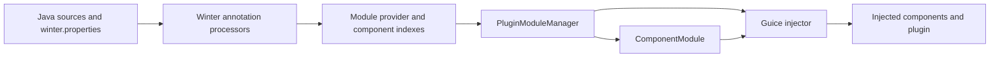

# Architecture

Winter uses generated metadata for discovery and Guice for runtime construction. There is no runtime classpath scan of every plugin class.

## Compile-time pipeline

1. `WinterProcessor` finds the `@WinterBootPlugin` class, loads `WinterProcessorExtension` implementations, and invokes them in a stable order.
2. `ComponentMetadataProcessor` finds `@Component` classes and stereotypes. `ComponentCompileInterceptor` providers may discard a candidate before indexing. The processor validates component visibility and nesting, records external components, and marks direct Bukkit/Paper references for synchronous loading.
3. The processor writes generated class wires and `ProcessorModuleProvider` in the boot class's `autogenerated_winter_modules` package. Libraries without a boot class can still publish `META-INF/winter/components.index`; synchronous types are listed in `META-INF/winter/sync-components.index`.
4. `ExposeAnnotationProcessorAPI` generates the public API interface from `@Expose`. The implementation processor generates its default Guice-backed implementation and `ExposeAPIModule` when the matching API interface is present.

## Runtime pipeline

`PaperWinterPlugin` scans generated module classes, loads them, creates a Guice injector, injects modules and the plugin, enables modules, and later disables them. `PluginModuleManager` resolves module dependencies and runs independent module work in parallel. `ComponentModule` resolves component order, applies conditions and admission policies, binds accepted components as singletons, creates their instances, and invokes handlers/decorators.

Generated metadata is an input to startup, so a library used by a consumer must be on both the compile and annotation processor paths. External classes must also be visible to the consumer's runtime class loader. See [Exposed APIs and multi-module builds](expose-and-multi-module.md).

## Ownership

`core` contains the component model, processors, Guice integration, scheduler interface, text helpers, and extension points. `paper` supplies the Paper boot class, Bukkit scheduler, listeners, and YAML integration. Addons should depend on these public entry points rather than generated implementation classes or internal metadata processors.
